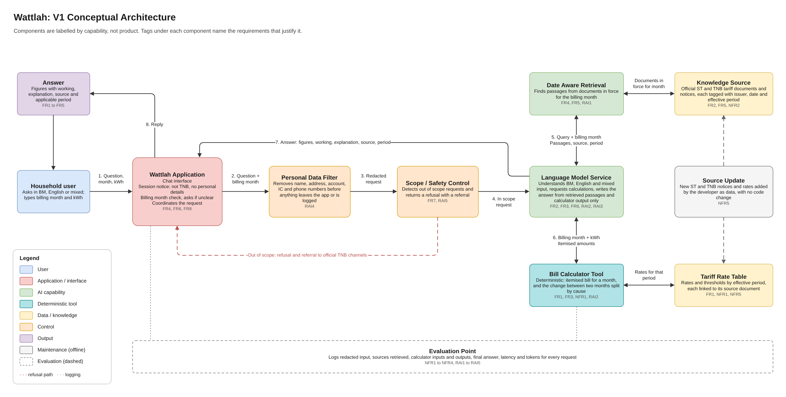

# Week 2 Architecture Decisions and Traceability: Wattlah

Version: 1.1 (22 November 2026). Changes are listed at the end.
Requirement IDs refer to [week2_requirements.md](week2_requirements.md); evaluation criteria to [week2_evaluation_criteria.md](week2_evaluation_criteria.md).

## 1. Starting Point: Simplest Architecture (C1)

User question → Wattlah Application → Language Model Service → Answer

**What it can do:** answer general questions about electricity bills in BM and English from the model's own knowledge.

**Why it is not enough for Wattlah:**
- The model's knowledge stops at its cutoff, so it cannot know the September 2026 threshold change (FR4, RAI1).
- It computes amounts inside the model, with no guarantee they are right (FR1, NFR1, RAI2).
- It gives no source and no applicable period (FR5).
- Nothing stops personal data reaching the model service (RAI4) or blocks out of scope requests (FR7, RAI5).

## 2. Architecture Needs from Requirements (C2)

| Requirement ID | What does the requirement need? | Architecture Response |
|---|---|---|
| FR1, NFR1, RAI2 | Every amount reproducible from the published rates for the right month | Bill Calculator Tool reading a Tariff Rate Table versioned by effective period |
| FR3 | The change between two months split by cause | Bill Calculator Tool run for both months, with the difference split by usage, AFA rate and relief |
| FR4, RAI1 | Rules from the right billing month; ask when the month is unclear | Effective period on every source, Date Aware Retrieval, and a billing month check in the application |
| FR2, FR5, NFR2 | Explanations grounded in official documents, with a source for each rule | Knowledge Source of official ST and TNB documents, reached through Date Aware Retrieval |
| FR6, RAI3 | BM, English and mixed input at equal quality | One Language Model Service path for both languages; parity measured at the Evaluation Point |
| FR7, RAI5 | Out of scope requests declined and redirected | Scope / Safety Control before the model writes an answer |
| FR8, RAI5 | Non affiliation and personal data notice | Session notice in the Wattlah Application |
| RAI4 | No identifiers sent to the model service or kept in logs | Personal Data Filter as the first step after input |
| NFR3, NFR4 | Latency and cost within target | Short request path: one model service, calculator runs locally; latency and tokens logged |
| NFR5 | Monthly updates without code changes | Rates and sources kept as data, updated through the Source Update path |
| NFR1 to NFR4, RAI1 to RAI5 | Evidence for every threshold | Evaluation Point logging each request |

## 3. V1 Conceptual Architecture (C3)

Editable source: [week2_architecture_v1.drawio](week2_architecture_v1.drawio)

| Component | Type | Role | Supports |
|---|---|---|---|
| Household user | User | Asks in BM, English or mixed; types billing period dates and kWh | - |
| Wattlah Application | Application / interface | Chat interface, session notice, billing month check, coordinates the request | FR4, FR6, FR8 |
| Personal Data Filter | Control | Removes identifiers before anything leaves the application or is logged | RAI4 |
| Scope / Safety Control | Control | Detects out of scope requests; returns refusal and referral | FR7, RAI5 |
| Language Model Service | AI capability | Understands the question, requests calculations, writes the answer from retrieved passages and calculator output only | FR2, FR3, FR6, RAI2, RAI3 |
| Date Aware Retrieval | AI capability | Finds passages from documents in force for the billing month | FR4, FR5, RAI1 |
| Knowledge Source | Data / knowledge | Official tariff documents and notices, each tagged with issuer, date and effective period | FR2, FR5, NFR2 |
| Bill Calculator Tool | Deterministic tool | Itemised bill for one billing period, split by calendar month as TNB does; change between two periods split by cause; two labelled results for 2027 | FR1, FR3, NFR1, RAI2 |
| Tariff Rate Table | Data / knowledge | Rates, thresholds, monthly AFA, EEI bands and charge rules by effective period, each linked to its source; the 2027 threshold stored as two labelled scenarios | FR1, NFR1, NFR5 |
| Source Update | Maintenance (offline) | New official notices and rates added by the developer as data | NFR5 |
| Evaluation Point | Evaluation | Logs redacted input, sources retrieved, calculator inputs and outputs, answer, latency and tokens | NFR1 to NFR4, RAI1 to RAI5 |
| Answer | Output | Figures with working, explanation, source and applicable period | FR1 to FR5 |

**Request flow (numbers match the diagram)**
1. The user asks a question, with the billing month and kWh where relevant. The application shows the session notice and checks the billing month, asking the user if it cannot be determined.
2. The application passes the question and billing month to the Personal Data Filter.
3. The redacted request goes to the Scope / Safety Control. Out of scope requests return a refusal with a referral to official TNB channels.
4. In scope requests go to the Language Model Service.
5. Date Aware Retrieval returns passages in force for the billing month, with source and effective period.
6. The Bill Calculator Tool returns itemised amounts from the Tariff Rate Table for that period.
7. The Language Model Service writes the answer from the passages and calculator output only.
8. The application replies: figures, working, explanation, source and applicable period.

The Evaluation Point records every step. Source Update runs offline and never sits in the request path.

## 4. Architecture Decision Record (C4)

| # | Decision | Requirement / Constraint | Alternatives Considered | Selected Option | Trade-off Accepted |
|---|---|---|---|---|---|
| ADR1 | How amounts are computed | FR1, NFR1, RAI2 | (a) Model computes amounts; (b) model computes and a second model checks; (c) deterministic calculator tool | (c) Calculator tool reading a Tariff Rate Table | Rates must be copied from official sources into the tables by hand, so transcription errors are possible; REF-CALC, with expected values from TNB's own calculation method, is the check. Only tariff cases coded in the calculator are supported, which is why ToU and solar are out of scope. |
| ADR2 | How the right rules are found | FR4, FR5, NFR2, RAI1 | (a) Model knowledge only; (b) retrieval over all documents; (c) retrieval filtered by effective period | (c) Date aware retrieval over effective dated documents | Every document needs its effective period tagged by hand. The billing month must be known before retrieval, so a vague question costs the user one extra turn. |
| ADR3 | Personal data handling | RAI4, PDPA | (a) Notice only; (b) reject any input containing identifiers; (c) filter identifiers out before the model and logs, plus a notice | (c) Filter plus notice | An extra step on every request. False positives may strip useful text, such as a long number that is really a meter reading; the PII set includes these cases. |
| ADR4 | Scope enforcement | FR7, RAI5 | (a) Instructions to the model only; (b) explicit scope control before the model answers | (b) Explicit Scope / Safety Control | Some valid bill questions may be wrongly refused, and each request takes slightly longer. Refusal accuracy must be measured in both languages. |
| ADR5 | V1 input method | RAI4, one semester, solo developer | (a) Typed billing month and kWh; (b) typed billing period dates and kWh; (c) bill photo or PDF upload with text extraction | (b) Typed dates and kWh; upload deferred to V2 | Users must read the kWh and both dates off their bill and type them. Dates are needed because TNB splits usage and thresholds by calendar month; a single month estimate is off by up to RM26 for a bill spanning 1 September 2026. Typing is less convenient and allows typing errors. In return V1 needs no text extraction component and never receives a full bill with personal details on it. |
| ADR6 | Language handling | FR6, RAI3 | (a) Separate BM and English pipelines; (b) translate to English, answer, translate back; (c) one bilingual path answering in the user's language | (c) One bilingual path, sources kept in their original language | BM quality depends on the model's own BM ability and is not guaranteed, so parity is measured (RAI3) rather than assumed. Model selection from Topic 3 onwards must be tested in BM, not English only. |
| ADR7 | Protection threshold from 1 January 2027 | FR1, RAI1, RAI2 | (a) Assume the 800 kWh relief continues; (b) assume it ends (600 kWh), as TNB's calculator does; (c) compute both and label them | (c) Two labelled results until the government announces | Longer answers with two totals that may confuse some users. When the decision is published, one data row changes and the second result disappears (NFR5). |
| ADR8 | Months with no declared AFA rate | FR1, RAI2 | (a) Use TNB's projected rate; (b) compute nothing and show the projection as a forecast | (b) No bill when usage is above the threshold in a month whose AFA rate is not declared; bills at or below the threshold need no AFA rate and are computed | Users above the threshold cannot estimate the current month until TNB declares the rate, usually around the 1st. No projected number is ever presented as a bill amount. |

## 5. Initial Requirements Traceability Matrix

| Objective | Requirement | Evaluation Criterion | Architecture Element | Later Evidence |
|---|---|---|---|---|
| O2, O3 | FR1, NFR1 | Calculation accuracy | Bill Calculator Tool, Tariff Rate Table | REF-CALC results |
| O1, O3 | FR3 | Bill change attribution | Bill Calculator Tool (two month run), Language Model Service | REF-PAIR results |
| O1, O3 | FR4, RAI1 | Applicable billing period | Knowledge Source (effective dated), Date Aware Retrieval, billing month check | PERIOD results |
| O1, O3 | FR2, FR5, NFR2 | Grounded and cited explanations | Knowledge Source, Date Aware Retrieval, Language Model Service | QA rubric scores and citation checks |
| O2, O3 | RAI2 | Figure traceability | Bill Calculator Tool, Evaluation Point | Figure trace audit across all sets |
| O1, O3 | FR6, RAI3 | BM and English parity | Language Model Service (one bilingual path), Evaluation Point | QA scores split by language |
| O2, O3 | FR7, FR8, RAI5 | Out of scope refusal and redirect | Scope / Safety Control, session notice | SCOPE results |
| O2, O3 | RAI4 | Personal data protection | Personal Data Filter | PII payload and log inspection |
| O2 | NFR5 | Update without code change | Tariff Rate Table, Source Update | Controlled update test record |
| O3 | NFR3, NFR4 | Response latency; cost per query | Evaluation Point | Latency and token logs |

All evidence is stored in `evaluation/` as it is produced.

## 6. Final Review

- **Does each major component support a requirement or evaluation need?** Yes. Every component in Section 3 maps to at least one requirement, and every requirement maps to at least one component.
- **Is any important data source, safety control or evaluation point missing?** Two known gaps, both accepted for V1: new official notices are found and added manually (NFR5 covers the update, not the discovery), and there is no memory across sessions, which V1 does not need.
- **Has any technology or component been added that is not yet justified?** No. Components are named by capability only. Models, retrieval method, storage and interface framework are chosen from Topic 3 onwards.
- **Is there a simpler architecture that could still satisfy the requirements?** Two simplifications were considered and rejected. Dropping the Scope / Safety Control and relying on model instructions would make RAI5 hard to test or enforce on its own (ADR4). Merging the Tariff Rate Table into the Knowledge Source would leave the calculator reading rates out of prose, which breaks the 100% target in NFR1 (ADR1).

## Reflection (Part C)

**Which architecture decision involved the most important trade-off? Which requirement drove the decision, and what trade-off did you accept?**

ADR1, the deterministic calculator, driven by FR1, NFR1 and RAI2. Letting the model compute would have covered every tariff case with no extra work, but with no guarantee that any single amount is right. A calculator is exact, but only for the cases I code, and only as correct as the rates I copy from the PDFs into the table. I accepted a narrower system (no ToU, no solar) plus the manual work of keeping the rate table right, because a wrong ringgit amount is the most damaging failure Wattlah can have. A tool that is always right on fewer cases is more useful to a household than one that covers everything and is sometimes wrong.

## Changes in Version 1.1 (22 November 2026)

- **ADR5:** input is the billing period (start and end dates) plus kWh, not a billing month.
- **ADR7, ADR8 added:** 2027 threshold shown as two labelled scenarios; no bill that needs an undeclared AFA rate.
- **Tariff Rate Table and Bill Calculator Tool:** now cover monthly AFA, EEI bands, KWTBB, service tax base, rounding and the calendar month split, following TNB's published calculation method.
- The V1 diagram is unchanged as the Week 2 record; the current design is [architecture_v2.png](architecture_v2.png).
