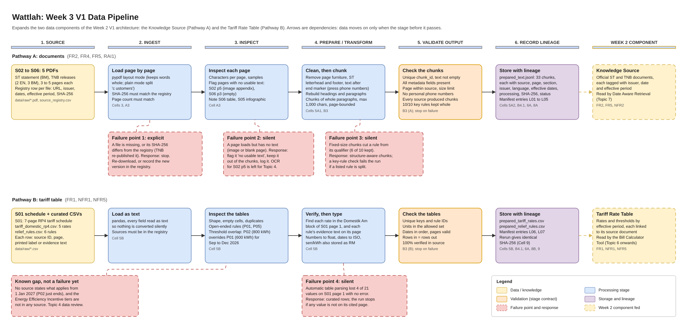

# Week 3 Pipeline Decisions, Stage Contracts and Traceability: Wattlah

Version: 1.0 (16 November 2026)
Builds on: [week2_requirements.md](week2_requirements.md), [week2_architecture_decisions.md](week2_architecture_decisions.md). Sources: [week3_data_inventory.md](week3_data_inventory.md). Notebook: [notebooks/week3_pipeline.ipynb](../notebooks/week3_pipeline.ipynb).

Editable source: [week3_pipeline_diagram.drawio](week3_pipeline_diagram.drawio)

## 1. Summary of Decisions

| Item | Decision |
|---|---|
| Topic 2 requirements served | FR1, NFR1 (exact rates); FR4, RAI1 (effective periods); FR2, FR5, NFR2 (cited, page-level sources); FR6, RAI3 (BM and English pair); NFR5 (rates as data); RAI4 (no personal data in outputs) |
| Selected sources | S01 to S06 (see inventory): 1 tariff schedule, 1 ST media statement, 4 TNB press releases (2 EN, 2 BM with S03 and S04 a matched pair) |
| Pathways | A, documents (S02 to S06) and B, tables (S01 via curated CSV). Two pathways because the Week 2 architecture has two data components: the Knowledge Source and the Tariff Rate Table |
| Pathway A configuration | pypdf layout extraction; justified cleaning (5 rules); structure-aware chunks of whole paragraphs under their section heading, max 1,000 characters, no overlap, never crossing a page or heading |
| Pathway B configuration | Curated CSV, every value verified word for word against the cited PDF page, fields typed, sen/kWh also stored as RM |
| ETL / ELT | Hybrid (Section 4) |
| Batch / streaming | Batch, run by hand when a new notice is published (Section 4) |
| Output | `data/processed/` (Part B), `data/week3_manifest.json`, `data/pipeline_v1/documents/` and `data/pipeline_v1/tables/` (Part C) |

## 2. Part B Comparison: Pathway A (Documents)

Same cleaned text from S02 to S06 for every configuration. "Rules kept" counts 10 rules that must stay in one chunk with their qualifier, for example the 800 kWh exemption with "September 2026 to 31 December 2026", in both languages.

| Configuration | Chunks | Mean chars | Start mid-word or mid-sentence | Rules kept | Extra text |
|---|---|---|---|---|---|
| Fixed-size 500 (lab code) | 45 | 469 | 35 | 6/10 | 0% |
| Paragraph-aware 500 (lab code) | 45 | 469 | 35 | 6/10 | 0% |
| Fixed-size 500, overlap 100 | 54 | 481 | 43 | 8/10 | +23% |
| Structure-aware 500 | 60 | 388 | 0 | 9/10 | +10% |
| Structure-aware 800 | 43 | 516 | 0 | 9/10 | +5% |
| Structure-aware 800, overlap 1 paragraph | 43 | 547 | 0 | 10/10 | +11% |
| **Structure-aware 1,000 (selected)** | **33** | **652** | **0** | **10/10** | **+2%** |

**Observed evidence**
- The extracted text has **no blank lines between paragraphs**, so the lab's paragraph-aware splitter found zero paragraphs and produced chunks identical to fixed-size. No error was raised. This is a silent failure of the method, not of the code.
- Fixed-size chunks cut the S05 exemption mid-word (`...Bahan Api Secara A`), leaving its effective period in the next chunk.
- At 500 and 800 characters, the S05 rule and its period sit in adjacent paragraphs under a 100-character title, so they still split. 1,000 keeps both.

**Selected:** structure-aware, 1,000 characters, no overlap.
- **Benefit:** every listed rule stays whole with its qualifier. Every chunk starts at a heading or a paragraph. Extra text is only the repeated section heading, which also gives each chunk its context.
- **Accepted limitation:** larger chunks send more text per retrieved passage (NFR4 cost) and may lower retrieval precision; to be measured in Topic 7. Page-bounded chunks split a paragraph that runs across a page break (needed for page citations, FR5). Chunk boundaries can still separate a lead-in from its list: S05 chunk c05 ends with "hubungi pasukan kami melalui:" and the contact list is in c06.

## 3. Part B Comparison: Pathway B (Tariff Table)

| Option | Evidence | Result |
|---|---|---|
| A: automatic parsing of S01 page 1 | 21 charge rows; 17 parsed with a value; 4 rows (Bukan Domestik Voltan Rendah Am) lost their values because reading order breaks inside that block. No error raised | Rejected: a rate table that is silently incomplete breaks NFR1 |
| **B: curated CSV verified against source (selected)** | 5 of 5 rates found in the Domestik Am block of S01 page 1; 6 of 6 rules found word for word on their cited page | Selected |

**Benefit:** turns the main risk accepted in ADR1, a transcription error, into a check that stops the run.
**Accepted limitation:** a person still types each new row, and the check proves the value is printed on the cited page, not that it went into the right column. REF-CALC, built independently (Topic 8), remains the final check.

## 4. ETL / ELT and Batch / Streaming

**Hybrid: raw landing, staged transformations, raw and prepared both kept.**
- Raw PDFs are kept as downloaded, identified by SHA-256 in the registry. Transformations run in stages: clean, then chunk (A); verify, then type (B). Prepared outputs are stored next to the raw.
- Why not pure ETL: chunk size will be re-tuned against retrieval results in Topic 7, so the raw text must stay available to reprocess.
- Why not pure ELT: an unverified rate must never reach the calculator, so validation happens before anything is stored as prepared.
- Reproducibility: rerunning gives byte-identical outputs (Cell 9). The notebook was run under two different base folders and produced identical files.

**Batch, triggered by hand.**
- Sources change at most monthly (one AFA rate per month) or at short notice (relief changes), and nothing needs to be available within minutes.
- Update path (NFR5): add the notice to the registry, add a row to `relief_rules.csv`, rerun the notebook. No code change.
- Streaming would add infrastructure with no benefit. Finding new notices is still manual, a gap already accepted in Week 2.

## 5. Stage Contracts

| Stage | Contract / evidence | Failure response |
|---|---|---|
| Ingest | Every registered source exists in `data/raw`, its SHA-256 matches the registry, and its page count matches (Cells 3, A3) | **Stop.** Re-download, or record the new version in the registry if the publisher changed the file |
| Inspect | Each page has at least 80 characters of usable text after cleaning; CSVs have the expected columns, and duplicates are counted (Cells A3, 5A1, 5B) | **Flag and exclude** pages with no usable text (S02 p5, S06 p3), log them. **Stop** if a whole document has no text (scanned PDF, needs OCR) |
| Prepare | A: chunks are page-bounded, under 1,000 characters, and carry heading context. B: every rate and rule is found on its cited page (Cells 5A2, 5B) | **Stop** if any value is not found in its source. Chunks with a known artifact are kept with `status: needs_review` (6 of 33) |
| Validate | A: unique `chunk_id`, required metadata present, page within source, no mobile phone numbers, every source produced chunks, 10/10 key rules whole. B: unique keys, allowed units, dates in order, rows in = rows out, 100% verified (B3 cells) | **Stop** on any failed check |
| Record lineage | Each source maps to its exact output with both SHA-256 values; the manifest re-verifies on read (Cells B4.1, 6A, 6B) | **Stop** if a file is missing or a checksum differs |

**Failure types met in this data**
- **Explicit:** the original ST URL returned HTTP 404. The registry now records the TNB-hosted copy and its checksum.
- **Silent:** S02 page 5 and S06 page 3 load with no usable text; the lab's paragraph splitter ran with no paragraphs; automatic table parsing lost 4 values. All four raised no error.
- **Partial:** not met. The ingest check stops and names the missing or changed source rather than continuing with the rest.

## 6. Provenance and Access Caveats

- **Raw PDFs are not committed** (Week 2 constraint). The registry holds each URL and SHA-256, so the exact file can be re-downloaded and proven identical.
- **Prepared chunks contain text extracted from the official releases.** They are public statements issued for dissemination; each chunk keeps its issuer, title, date, URL and page. Remove `data/processed/prepared_text.jsonl` from the public repo if the lecturer's rules on redistribution are stricter.
- **S02 is a TNB-hosted copy** of the ST statement, re-saved from a browser in August 2026. Its text matches the statement, but it is not ST's original file.
- **S03 and S04 are partly superseded:** their 600 kWh threshold does not apply to September to December 2026 usage. Each of their chunks carries this note.
- **Personal data:** press officers' names and mobile numbers (S03 page 3) are removed by cleaning, and the output check would fail if a mobile number got through.

## 7. Updated Traceability

| Objective | Requirement | Architecture element | Week 3 data artefact | Evidence produced |
|---|---|---|---|---|
| O2, O3 | FR1, NFR1 | Tariff Rate Table | `prepared_tariff_rates.csv` (5 rates, R01 to R05) | 5/5 rates verified against S01 page 1 |
| O1, O3 | FR4, RAI1 | Knowledge Source (effective dated) | `prepared_relief_rules.csv` (P01 to P06, dated); `effective_from` / `effective_to` on every chunk | 6/6 rules verified; P02 overrides P01 for Sep to Dec 2026 |
| O1, O3 | FR2, FR5, NFR2 | Knowledge Source | `prepared_text.jsonl` (33 chunks with issuer, title, date, page, section) | Output contract PASS; 10/10 key rules whole |
| O1, O3 | FR6, RAI3 | Knowledge Source | S03 (EN) and S04 (BM) as a matched pair, `language` field on every chunk | 7 chunks each, same sections |
| O2, O3 | RAI4 | Pipeline cleaning step | Press contacts removed before storage | No mobile number pattern in any chunk |
| O2 | NFR5 | Tariff Rate Table, Source Update | `source_registry.csv`, `relief_rules.csv` as data | Update path needs no code change |
| O3 | All | Evaluation Point | `week3_manifest.json`, `pipeline_v1/*/pipeline_manifest.json` | Lineage PASS (7 entries); repeatability PASS |

## 8. Findings That Affect the Week 2 Documents

1. **The 1 January 2027 reversion is not in any official source used here.** RAI1 and the PERIOD test set in Week 2 assume it. S05 and S06 only say the 800 kWh relief runs until 31 December 2026. P01 applying again afterwards is an inference from that end date. An official statement is needed before PERIOD cases test it.
2. **The Energy Efficiency Incentive is missing from the rate table.** S02 says households using up to 1,000 kWh get it, and S02's appendix example shows -25.00 sen/kWh at 150 kWh. The tier table is not in any current source, so FR1 bills would be wrong for most households until it is added. To be sourced in Topic 4.
3. **Only one AFA month is sourced (September 2026).** REF-CALC needs rebate and surcharge months; each month needs its own official notice in the registry.
4. **ToU off-peak public holidays disagree across sources:** S02 says nothing, S03 says "Public Holidays", S06 says "selected Public Holidays". ToU is out of V1 scope, so this is logged, not resolved.

## 9. Engineering Checklist (Lecture Slide 18)

| Question | Answer |
|---|---|
| Why did you choose this source? | Each maps to a Week 2 requirement (inventory, A1). They are the official issuers, and they include the 600 to 800 kWh change that RAI1 must handle |
| What did the loader actually return? | Page counts and characters per page for all six files; three pages with no usable text, flagged (inventory, A4) |
| What did you clean, and why? | Five rules, each justified in the notebook; the CareLine block was kept on purpose because FR7 needs it |
| Why this chunking configuration? | Section 2: the only no-overlap configuration that keeps all 10 rules whole |
| Can every prepared unit be traced back to its source? | Yes: every chunk has source ID, file, URL, page and SHA-256; every rate and rule has source ID, page and evidence text; the manifests verify both |
| What can fail in this pipeline? | Section 5, and four failure points on the diagram |
| What have we left for later topics? | Topic 4: OCR or manual transcription of S02 page 5, Energy Efficiency Incentive tiers, more AFA months, the 2027 reversion source, review of the 6 `needs_review` chunks. Topic 7: embeddings, the vector index and retrieval tests on chunk size |
